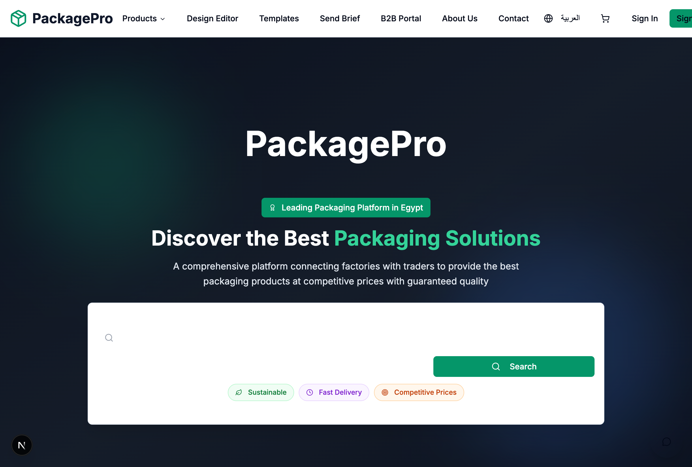
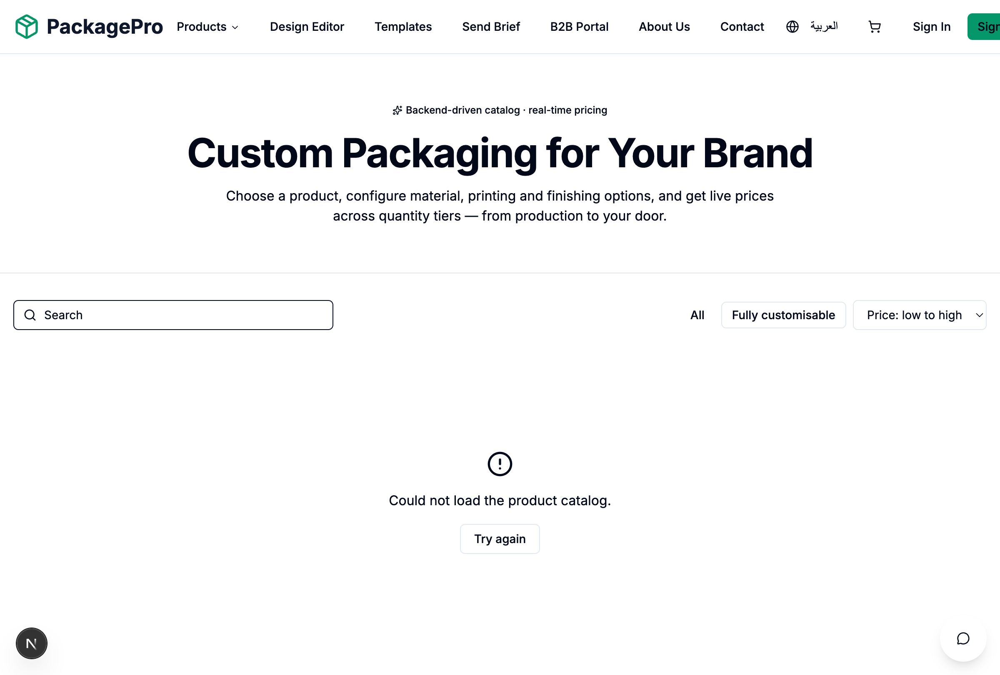
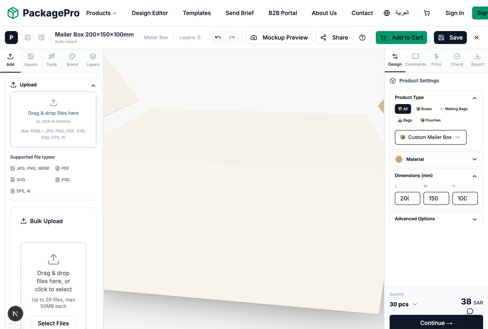

# PackagePro

**PackagePro — Custom Packaging Marketplace.**

A full-stack packaging marketplace: a **custom packaging marketplace** that
connects factories with traders — catalog + search, custom design editor,
dynamic quoting, Stripe payments, vendor routing, production & QA workflow,
DHL fulfilment, settlements and analytics — implemented as a monorepo with a
Fastify + PostgreSQL backend and a Next.js frontend.

[](https://github.com/Ma7moudll/packagepro/actions)
[](https://www.typescriptlang.org/)
[](https://nextjs.org/)
[](https://www.fastify.io/)

## Screenshots

| Home | Catalog | Design editor |
|---|---|---|
|  |  |  |

> Screenshots show the frontend run locally against its seed data.

## 🚀 Quick Start

**This is the fastest way to get started:**

```bash
# 1. Clone the project
git clone https://github.com/Ma7moudll/packagepro.git
cd packagepro

# 2. Run the setup script
chmod +x scripts/setup.sh
./scripts/setup.sh

# 3. Run the project
# Terminal 1: Backend
cd backend && npm run dev

# Terminal 2: Frontend
cd frontend && npm run dev
```

**App access:**
- Frontend: http://localhost:3001
- Backend API: http://localhost:3000
- API Docs: http://localhost:3000/api
- Database Studio: `cd backend && npm run prisma:studio`

## 📚 Documentation

- 📊 **[PROJECT_REVIEW.md](docs/PROJECT_REVIEW.md)** - Comprehensive project review
- 📋 **[ACTION_PLAN.md](docs/guides/ACTION_PLAN.md)** - Action plan
- ⚡ **[QUICK_SUMMARY.md](docs/QUICK_SUMMARY.md)** - Quick summary
- 🧪 **[TESTING_GUIDE.md](docs/guides/TESTING_GUIDE.md)** - Testing guide
- 🚀 **[DEPLOYMENT_GUIDE.md](docs/guides/DEPLOYMENT_GUIDE.md)** - Deployment guide
- 🤝 **[CONTRIBUTING.md](CONTRIBUTING.md)** - Contribution guide
- 🏗️ **[ARCHITECTURE.md](docs/ARCHITECTURE.md)** - Architecture documentation
- ✅ **[COMPLETION_SUMMARY.md](docs/guides/COMPLETION_SUMMARY.md)** - Completion summary

## Project Structure

```
packagepro/
├── backend/          # Fastify + TypeScript Backend
├── frontend/         # Next.js 15 Frontend
├── shared/           # Shared types and utilities
├── docs/             # Documentation
├── .github/          # GitHub Actions & Workflows
└── *.md              # Documentation files
```

## Prerequisites

- Node.js 20+
- PostgreSQL 15+
- Redis 7+
- Docker & Docker Compose (optional)
- npm or pnpm

### Backend Setup

1. Navigate to backend directory:
```bash
cd backend
```

2. Install dependencies:
```bash
npm install
```

3. Set up environment variables:
```bash
cp env.example .env
# Edit .env with your configuration
```

4. Set up database:
```bash
npm run prisma:generate
npm run prisma:migrate
npm run prisma:seed
```

5. Start development server:
```bash
npm run dev
```

Backend will run on `http://localhost:3000`

### Frontend Setup

1. Navigate to frontend directory:
```bash
cd frontend
```

2. Install dependencies:
```bash
npm install
```

3. Set up environment variables:
Create `.env.local`:
```
NEXT_PUBLIC_API_URL=http://localhost:3000
```

4. Start development server:
```bash
npm run dev
```

Frontend will run on `http://localhost:3001`

## API Overview

API endpoints are available at `/api`. Main endpoints:

### Authentication
- `POST /api/auth/register` - Register new user · `POST /api/auth/login` - Login · `POST /api/auth/refresh` - Refresh token

### Pricing
- `POST /api/pricing/calculate` - Calculate price · `GET /api/pricing/materials` - Get materials

### Orders
- `POST /api/orders` - Create order · `GET /api/orders/:id` - Get order · `GET /api/orders` - List orders · `PATCH /api/orders/:id/status` - Update status

### Designs
- `POST /api/designs/session` - Create design session · `POST /api/designs/save` - Save design · `GET /api/designs/:id` - Get design

### Payments
- `POST /api/payments/create-intent` · `POST /api/payments/confirm` · `POST /api/webhooks/stripe`

### Pre-Press & Approval
- `POST /api/orders/:id/prepress-check` · `GET /api/orders/:id/prepress-results` · `POST /api/orders/:id/request-approval` · `POST /api/orders/:id/approve`

### Purchase Orders
- `POST /api/orders/:id/create-po` · `GET /api/purchase-orders/:id` · `POST /api/purchase-orders/:id/confirm`

### Production
- `POST /api/production/start/:poId` · `POST /api/production/:id/progress` · `GET /api/production/:id`

### Samples & QA
- `POST /api/production/:productionId/samples` · `POST /api/samples/:id/approve` · `POST /api/samples/:id/reject`

### Shipping
- `POST /api/shipments/create/:id` · `GET /api/shipments/:id/tracking` · `POST /api/webhooks/dhl`

### Reviews
- `POST /api/reviews` · `GET /api/reviews/order/:orderId` · `GET /api/vendors/:id/reviews`

### Settlements & Finance
- `POST /api/settlements/process/:id` · `GET /api/vendors/:id/payments` · `GET /api/finance/reports`

## Key Features

- **Marketplace catalog** — search, categories, verified factories, featured products, sample requests.
- **Dynamic Pricing Engine** — real-time quoting over materials and specs (`/api/pricing/calculate`).
- **Custom Design Editor** — design sessions, save/session API. There are 15 starting-point design presets (`frontend/lib/editor/data/templates.ts`). That is separate from the product catalogue (`shared/catalog/products.ts`), which lists 55 product types. Catalogue readiness at this revision is 1 supported, 30 in progress and 24 unavailable, so the catalogue size is not a count of finished or orderable products.
- **Order lifecycle** — orders → pre-press quality check → soft-proof approval → vendor router (multi-criteria scoring + 4h handshake) → PO (PDF) → production/QA → DHL shipment → settlement (72h) → reviews.
- **Payments** — Stripe payment intents + webhooks (also PayPal/COD scaffolding).
- **Security baseline** — JWT (15 min access + 7d refresh), bcrypt cost 12, Redis rate limiting with exponential backoff + reCAPTCHA v3, persistent AuditLog.
- **Jobs & integrations** — BullMQ workers (email, settlement, reminders, marketing, export), SendGrid/SES email service, S3/R2 file storage + image optimization, DHL tracking.

## Technology Stack

### Backend
- Fastify 4 (web framework) · Prisma 5 ORM · PostgreSQL · Redis
- BullMQ (job queues) · Stripe (payments) · AWS S3 / CloudFlare R2 (files)
- JWT auth · bcrypt (cost 12) · reCAPTCHA v3 · nodemailer (SendGrid/SES)
- pdfkit / pdf-lib (PO & reports)

### Frontend
- Next.js 15 (App Router) · React 19 · TypeScript 5.3
- Tailwind CSS · 3D package preview · design editor

## CI/CD

- `.github/workflows/ci.yml` — lint, type-check, tests and build on push/PR.
- `.github/workflows/deploy.yml` — deployment pipeline stub.
- `.github/dependabot.yml` — dependency updates.

## Environment Variables

See `backend/env.example` for all required environment variables
(database, Redis, JWT, S3/R2, Stripe, DHL, email providers, analytics).

## Status & Known Limitations

- **Backend is the most complete part** — 17 modules, 11 services, 18 Prisma
  tables, 5 BullMQ workers, Stripe/DHL/SES wired (per `docs/guides/COMPLETION_SUMMARY.md`). The **frontend marketplace is the active focus** (connecting real APIs per `SPEC-029`); several pages currently render seed/fixture data.
- **Third-party credentials are required, not bundled** — Stripe, DHL,
  SendGrid/SES, S3/R2, reCAPTCHA and analytics keys come from `backend/.env`
  (`cp env.example .env`). None are committed (`.env` is gitignored).
- **Not deployed** — `deploy.yml` is a pipeline stub; production hosting and
  environment provisioning are the operator's responsibility.
- Backend tests run with Vitest; both packages expose `npm run lint`.
- The FAQ/statistics on the landing page show seed figures until wired to the live API.